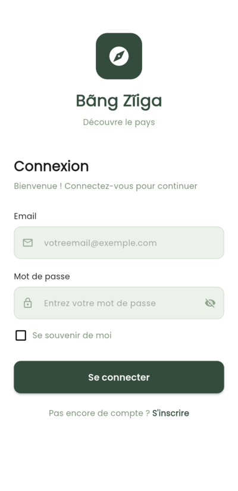
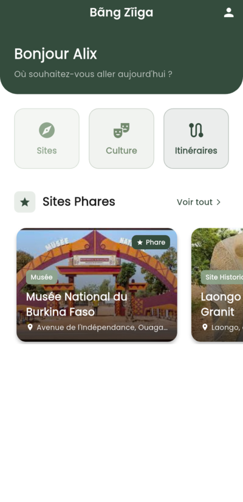
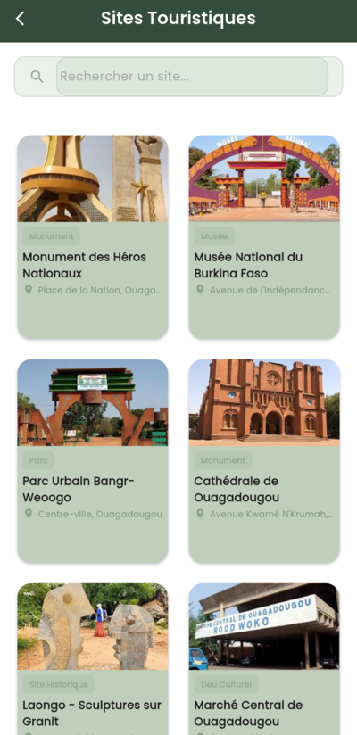
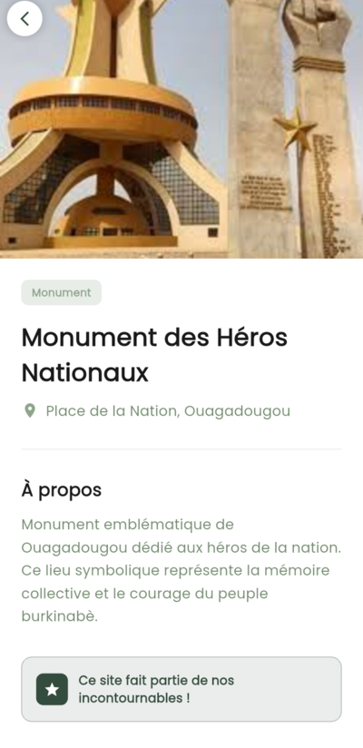
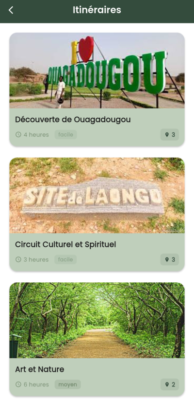
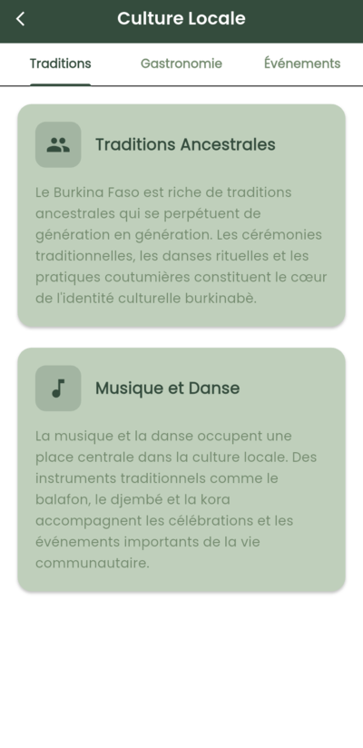
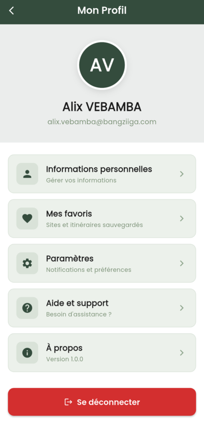
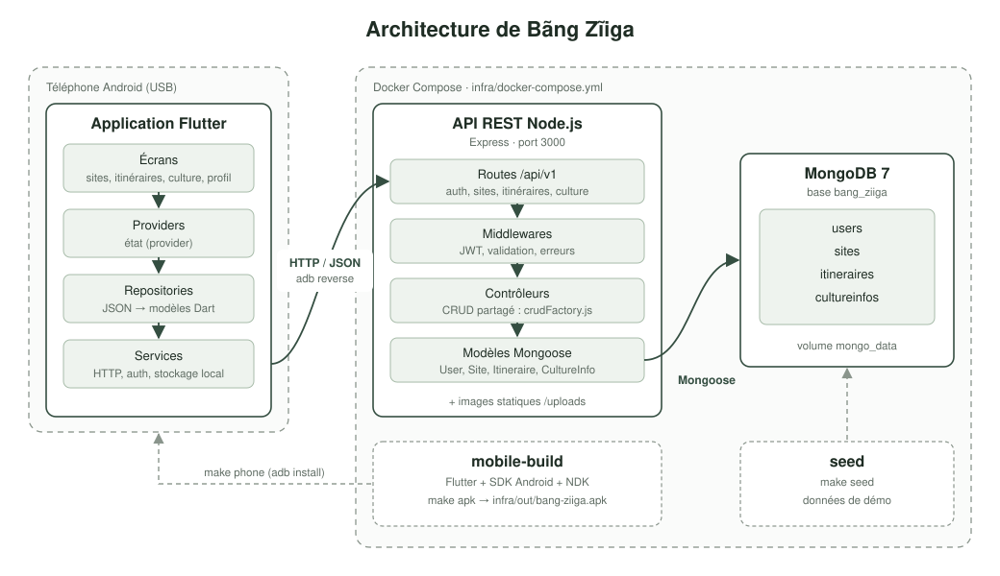

# Bãng Zĩiga

Application mobile de tourisme local pour le Burkina Faso : sites touristiques et
culturels, itinéraires de visite et repères sur la culture locale. Application
Flutter adossée à une API REST Node.js et MongoDB.

[](https://opensource.org/licenses/MIT)
[](https://nodejs.org/)
[](https://flutter.dev/)
[](https://www.mongodb.com/)

## Aperçu

Captures prises sur un appareil Android connecté à la stack locale.

<table>
  <tr>
    <th>Connexion</th>
    <th>Accueil</th>
    <th>Sites touristiques</th>
    <th>Détail d'un site</th>
  </tr>
  <tr>
    <td></td>
    <td></td>
    <td></td>
    <td></td>
  </tr>
  <tr>
    <th>Itinéraires</th>
    <th>Culture locale</th>
    <th>Profil</th>
  </tr>
  <tr>
    <td></td>
    <td></td>
    <td></td>
  </tr>
</table>

## Démarrage

Tout tourne dans Docker : rien à installer d'autre que Docker et `make`.

```bash
cd infra
make up      # MongoDB et l'API sur http://localhost:3000
make seed    # jeu de données de démonstration
make apk     # APK -> infra/out/bang-ziiga.apk (premier build long)
make phone   # installe et lance sur le téléphone branché en USB
make clean   # supprime tout : conteneurs, données, caches
```

Détails (fichiers, tunnel `adb reverse`, variables) : [infra/README.md](infra/README.md).

## Architecture

<p align="center">
  
</p>

## Documentation

| Document | Contenu |
|---|---|
| [Fonctionnalités](docs/fonctionnalites.md) | Ce que fait l'application |
| [Architecture](docs/architecture.md) | Couches, stack technique, structure des dossiers |
| [API REST](docs/api.md) | Points d'entrée exposés (collection Postman : `docs/postman_collection.json`) |
| [Qualité et limites](docs/qualite-et-limites.md) | Tests, analyse statique, points non traités |
| [Infra Docker](infra/README.md) | Compose, Makefile, build de l'APK, téléphone |

## Licence

MIT. Voir le fichier de licence du dépôt.
