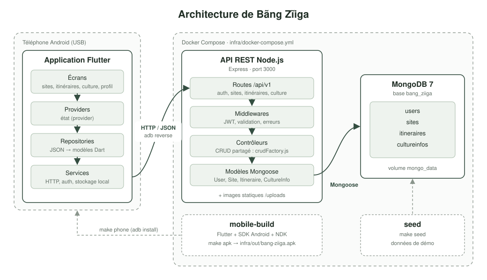

# Architecture



L'application mobile ne connaît que l'API. Elle est organisée en quatre couches:
les écrans affichent, les providers portent l'état, les repositories traduisent les
réponses de l'API en modèles, et les services parlent le HTTP.

Côté serveur, chaque ressource suit le même chemin: une route déclare le verbe et
les protections, un contrôleur applique la logique, un modèle Mongoose valide et
persiste. Les opérations CRUD communes aux sites, aux itinéraires et aux
informations culturelles sont produites par une fabrique partagée,
`src/controllers/crudFactory.js`.

Les images des sites sont servies en statique depuis `backend/uploads`, sous le
préfixe `/uploads`.

## Stack technique

### Backend

| Rôle | Technologie |
|---|---|
| Runtime | Node.js 18 ou plus |
| Framework web | Express 4 |
| Base de données | MongoDB 7, via Mongoose 8 |
| Authentification | JSON Web Token, bcryptjs |
| Sécurité | Helmet, CORS, express-rate-limit |
| Validation | express-validator |
| Journalisation | Morgan |
| Compression | compression |

### Frontend

| Rôle | Technologie |
|---|---|
| Framework | Flutter 3 |
| Gestion d'état | provider |
| Réseau | http |
| Stockage local | shared_preferences |
| Cache d'images | cached_network_image |
| Typographie | google_fonts |
| Validation d'email | email_validator |

## Structure du projet

```
bang-ziiga-project/
├── backend/
│   ├── server.js                 point d entree
│   ├── src/
│   │   ├── app.js                configuration Express
│   │   ├── config/               connexion MongoDB
│   │   ├── controllers/          logique metier, dont crudFactory.js
│   │   ├── middlewares/          authentification, validation, erreurs
│   │   ├── models/               schemas Mongoose
│   │   ├── routes/               declaration des endpoints
│   │   ├── seeders/              jeu de donnees de developpement
│   │   └── utils/
│   └── uploads/                  images servies en statique
├── frontend/
│   ├── lib/
│   │   ├── core/                 theme, couleurs, constantes, widgets partages
│   │   ├── data/repositories/    acces aux donnees de l API
│   │   ├── models/               modeles metier
│   │   ├── providers/            gestion d etat
│   │   ├── screens/              ecrans et widgets propres a un ecran
│   │   ├── services/             client HTTP, authentification, stockage
│   │   └── utils/
│   └── test/                     tests unitaires et de widgets
├── infra/                        Dockerfiles, docker-compose, Makefile, scripts
└── docs/                         documentation, captures, collection Postman
```
